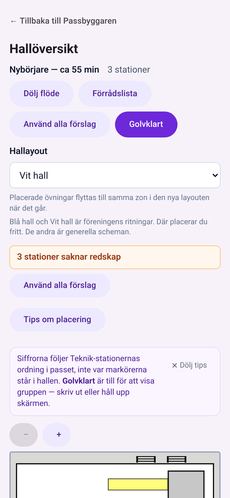
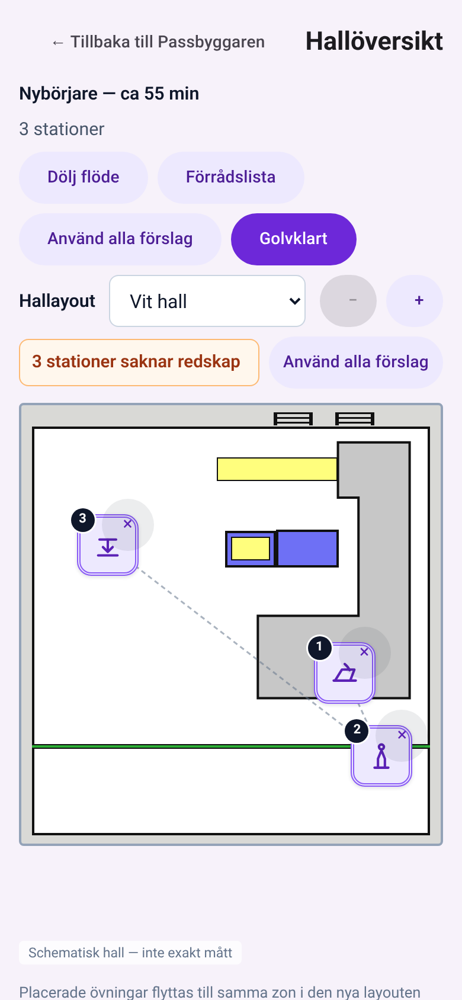
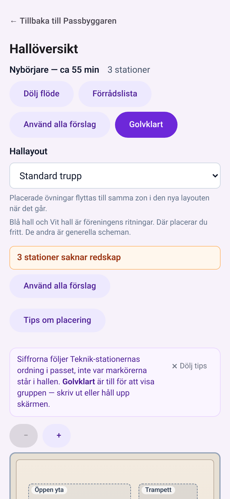
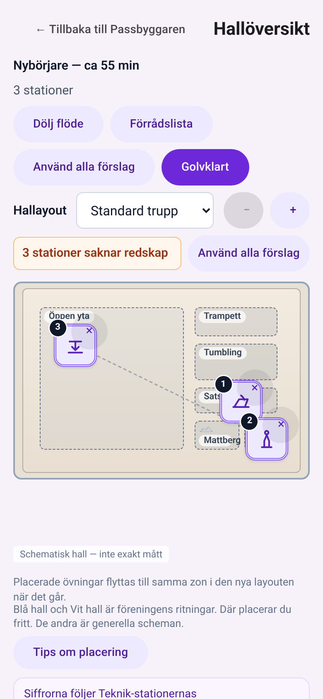
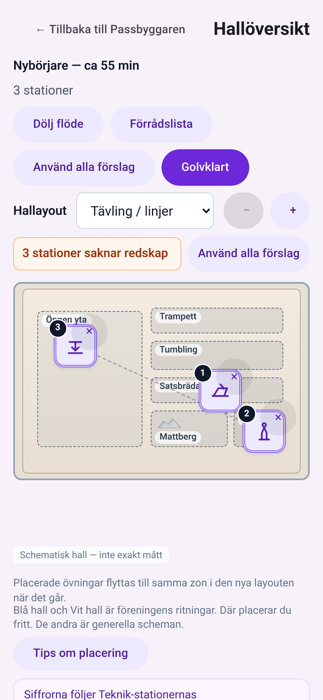
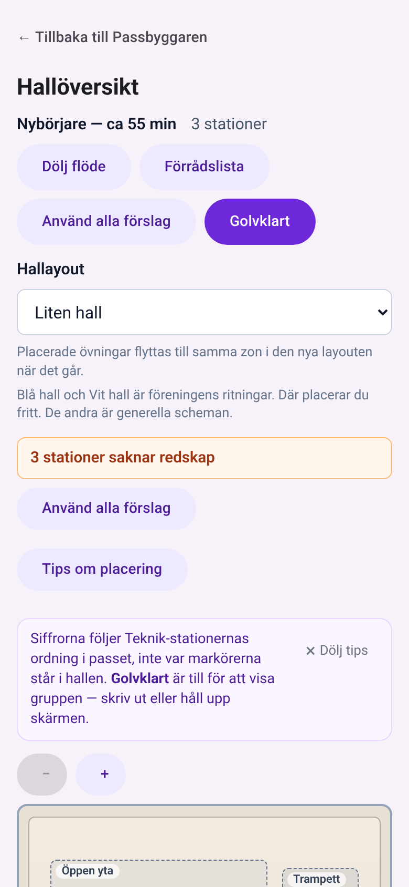

# Slice 43 — Hela hallen syns direkt (shipped notes)

Branch `slice-43-code` off `main` @ `db11398` + docs pack `d6548c1`. Locked A1 B1 C1 D1 E1 F1.

## What changed
- **B1:** the phone (≤ 768) `.hall-canvas` rule drops `min-height: 50vh` → `min-height: 0`, so the generic halls are 3:2 (239 px at 358 wide). The print rules in `App.css` (`@media print` block) and `export.css` are untouched.
- **C1 (all widths, same DOM order):** the migrate note, the Blå/Vit coach tip, the multi-line hints / Visa tips and the flow coach tip move out of the edit header into `
`, after «Schematisk hall — inte exakt mått» and before the tray. Same conditions, same text; tip dismiss unchanged.
- **D1:** the zoom − / + JSX is now `zoomBar`. Edit mode renders it inside `.hall-preset-row`; Golvklart keeps it above the hall, unchanged. Portrait-phone-only CSS (`@media (max-width: 768px) and (orientation: portrait)`, at the end of `App.css`):
  - (a) the header is a 2-column grid, so ← back and «Hallöversikt» share one row (`.hall-header-main` is `display: contents`; the DOM is unchanged, so desktop is unchanged);
  - (b) label + select (`flex: 1`) + − / + share one row, and the label stays a visible `<label>`;
  - (c) the saknar banner is one row, with the text ellipsized if needed, `title` = the same text, and the CTA ≥ 44 px with padding 12.
- `SLICE_NUMBER = '43'`; asserts bumped. No strings, no state, no new component.

## Decisions
1. **Layout label kept visible, inline left of the select.** HANDOFF says to hide it only if Planner OKs; it fits at 390.
2. **Zoom −/+ min-height 44 inside the layout row.** They were 40 px on main; AC5 asks ≥ 44.
3. **The saknar CTA needed higher specificity** (`.hall-saknar-banner .hall-saknar-point-cta`), because `export.css` (loaded after `App.css`) sets `.btn-secondary { padding: 0 24px; min-height: 40px }`.
4. **E1 DOM moves apply everywhere:** on landscape and desktop the moved items sit under the hall, so the hall starts higher there (landscape 507 → 313, desktop 507 → 313), with the same hall size.

## Measurements (390×844, DPR 2, Nybörjare, edit, saknar banner showing, scrollY 0; budget = canvas bottom ≤ 739)
| Hall | main top–bottom (h) | branch top–bottom (h) | Budget |
|---|---|---|---|
| Blå hall | 765–1029 (264) | **340–604** (264) | ✅ 135 spare |
| Vit hall | 765–1139 (374) | **340–714** (374) | ✅ 25 spare |
| Standard trupp | 765–1187 (422) | **340–579** (239) | ✅ 160 spare |
| Tävling / linjer | 765–1187 (422) | **340–579** (239) | ✅ |
| Liten hall | 765–1187 (422) | **340–579** (239) | ✅ |
| Golvklart (Vit) | 293–667 | 293–667 (unchanged) | ✅ |
| Landscape 844×390 (Blå) | 507–918 | 313–723 | top ≤ 507 ✅ |
| Desktop 1280×800 (Blå) | 507–1102 | 313–907 | same size ✅ |

The chrome above the hall is now 12–332 (back+title 12–60, meta 68–120, actions 128–224, layout+zoom 232–276, saknar 284–328), against README's estimate of the hall at 302. The meta line wraps to 2 lines (pass title, then count), which is where the ~38 px difference comes from. Vit still fits with 25 px to spare.

## Verification
- `bun test src` 220/0; `bun test tools/bank` 26/26; `npx tsc -b` clean; `npm run lint` 0 errors; `npm run build` ok.
- Smoke `verifier/slice-43-builder-smoke.mjs` (main :4310 vs branch :4343): **19/19** — AC1–AC7, AC10–AC14, the footer and no page errors. Measurements are in `verifier/slice-43-builder-smoke-results.json`.
- Not verified: AC9 (a pass with no saknar banner — the banner only adds height, so the hall moves up 48 px; not run), AC12 markers tap/drag/remove and pinch (only zoom + / − was checked), AC15 print/export (rules untouched, not printed), AC8 by inspection (no strings touched), a real-device PWA check (README open item 2).

## Screenshots (390×844, before = main db11398, after = branch)
| Hall | Before | After |
|---|---|---|
| Blå |  |  |
| Vit |  |  |
| Standard trupp |  |  |
| Tävling / linjer |  |  |
| Liten hall |  |  |

Also: `slice43_{main,branch}_golvklart_vit`, `_landscape_forening-bla`, `_desktop_forening-bla`, `slice43_branch_below` (moved items under the hall).

## Bundle (F1, gzip -9, sum of dist/assets/*.js + *.css)
| | main db11398 | branch | Δ |
|---|---|---|---|
| JS | 204 796 | 204 838 | +42 |
| CSS | 14 215 | 14 362 | +147 |
| **Total** | 219 011 | 219 200 | **+189** |
